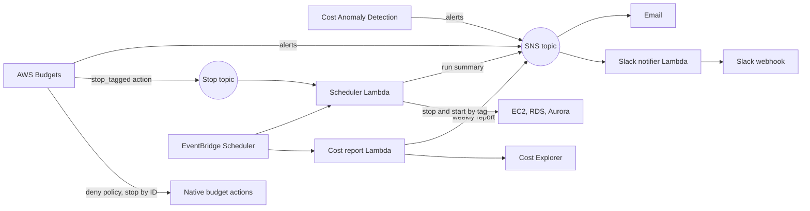

# terraform-aws-finops-baseline

Terraform module that gives a single AWS account a FinOps baseline: budgets, cost anomaly alerts, a tag-based dev scheduler, weekly cost reports and opt-in budget actions, with Slack and email alerts.

> **Status:** pre-1.0. The interface can change between minor releases. Read [Limitations and gotchas](#limitations-and-gotchas) before you rely on it.

## What it does

One module block sets up the cost controls a solo developer, startup or side project needs:

- **Budgets.** One monthly account budget, plus optional budgets for a tag or a service. Each alerts on actual and forecast spend.
- **Cost anomaly alerts.** Cost Anomaly Detection that alerts only when an anomaly costs at least a dollar amount **and** a percent above expected spend.
- **Cost allocation tags.** Activates your tag keys so tag budgets and tag monitors can see them.
- **Dev scheduler.** Stops and starts tagged EC2 instances, RDS instances and Aurora clusters outside working hours.
- **Weekly cost report.** Month-to-date spend against the budget, a forecast, top services, the biggest change and open anomalies.
- **Budget actions.** Opt-in responses when a budget passes a threshold: deny new spend, stop resources by ID, or stop everything the scheduler tags.

Alerts go to email through SNS and to Slack through an incoming webhook. Every feature uses the same topic, the same naming and the same tags.



The root module wires standalone submodules. You can use any of them on their own. See [Submodules](#submodules).

## Quick start

```hcl
module "finops" {
  source = "mikmorley/finops-baseline/aws"

  notifications = {
    emails = ["ops@example.com"]
  }

  account_budget = {
    limit_usd = 100
  }
}
```

This gives you a US$100 monthly budget with alerts at 50%, 80% and 100% of actual spend and 100% of forecast, cost anomaly alerts for US$10 and 20%, and a weekly cost report on Mondays at 09:00 UTC. The full example is in [`examples/basic`](examples/basic).

After you apply, each address gets a confirmation email from AWS. Alerts do not arrive until the recipient clicks the link.

[`examples/complete`](examples/complete) turns everything on: Slack, tag and service budgets, budget actions, a tag monitor, tag activation, the scheduler in dry-run mode and the report in another time zone.

## Feature reference

Every input has a safe default except `notifications` and `account_budget`. The inputs and outputs are listed at the end of this page. Each feature has a README with the details.

| Input | Feature | Default |
|---|---|---|
| `notifications` | Email and Slack alerts, KMS keys, Lambda logs. [Notifications](modules/notifications/README.md) | Required |
| `account_budget` | The monthly account budget and its actions. [Budgets](modules/budgets/README.md) | Required |
| `tag_budgets`, `service_budgets` | Extra budgets for a tag or a service | None |
| `anomaly_detection` | Anomaly alerts for US$10 **and** 20%. [Anomaly detection](modules/anomaly-detection/README.md) | On |
| `cost_allocation_tag_keys` | Tag keys to activate. [Cost allocation tags](modules/cost-allocation-tags/README.md) | None |
| `scheduler` | Stop and start tagged resources. [Scheduler](modules/scheduler/README.md) | Off |
| `cost_report` | The weekly report. [Cost report](modules/cost-report/README.md) | On |

### Slack

Create an incoming webhook in Slack, then store the URL yourself as an SSM SecureString parameter. The module takes the parameter name and never sees the URL, so the URL never lands in Terraform state:

```sh
aws ssm put-parameter --name /finops/slack-webhook --type SecureString --value 'https://hooks.slack.com/services/...'
```

Then set `notifications.slack_webhook_ssm_param = "/finops/slack-webhook"`. Create the parameter in the region where you apply the module.

### Budget actions

Actions are off by default. Add them under a budget's `actions`:

```hcl
account_budget = {
  limit_usd = 100
  actions = {
    deny-new-spend = { type = "deny_policy", threshold_percent = 100, roles = ["dev-deployer"], approval_model = "MANUAL" }
    stop-dev       = { type = "stop_tagged", threshold_percent = 120 }
  }
}
```

| Type | At the threshold | Approval |
|---|---|---|
| `deny_policy` | AWS attaches a deny policy to the listed roles | Automatic or manual |
| `stop_ec2`, `stop_rds` | AWS stops the listed instances | Automatic or manual |
| `stop_tagged` | The scheduler Lambda stops everything with its tag | None |

`stop_tagged` needs `scheduler.enabled = true`, and the plan fails without it. It runs through an SNS topic and has no approval step. See the [budgets README](modules/budgets/README.md#actions).

## Submodules

Each submodule has its own README and works without the root module:

| Submodule | Source |
|---|---|
| [notifications](modules/notifications/README.md) | `mikmorley/finops-baseline/aws//modules/notifications` |
| [budgets](modules/budgets/README.md) | `mikmorley/finops-baseline/aws//modules/budgets` |
| [anomaly-detection](modules/anomaly-detection/README.md) | `mikmorley/finops-baseline/aws//modules/anomaly-detection` |
| [cost-allocation-tags](modules/cost-allocation-tags/README.md) | `mikmorley/finops-baseline/aws//modules/cost-allocation-tags` |
| [scheduler](modules/scheduler/README.md) | `mikmorley/finops-baseline/aws//modules/scheduler` |
| [cost-report](modules/cost-report/README.md) | `mikmorley/finops-baseline/aws//modules/cost-report` |

## Providers and regions

The module has no provider block and does not set the per-resource `region` argument. It uses whichever AWS provider you pass.

- Budgets, Cost Explorer and Cost Anomaly Detection are global services. The AWS provider picks their endpoints, and the cost report Lambda always calls Cost Explorer and Budgets through `us-east-1`.
- The SNS topic, the Lambdas and the schedules live in the provider's region. The Lambdas publish to SNS in their own region, so keep everything in one region.
- The scheduler only sees EC2 and RDS resources in its region. For other regions, add a scheduler submodule per region with an aliased provider and a different `name_prefix`.

To use a different region from your default, pass an aliased provider:

```hcl
module "finops" {
  source    = "mikmorley/finops-baseline/aws"
  providers = { aws = aws.us_east_1 }
  # ...
}
```

## Cost of running it

Budget monitoring and alerts are free. The module itself costs cents a month:

- The cost report makes five Cost Explorer requests a run at US$0.01 each. That is US$0.05 a week, about US$0.22 a month.
- The Lambdas, the schedules, the logs and the SNS messages add fractions of a cent at this volume.

**Budget actions can change that.** AWS gives you two budgets with native actions for free (`deny_policy`, `stop_ec2`, `stop_rds`). Each further budget with one costs about US$0.10 a day, about US$3 a month, however many actions it has. The `native_action_budget_count` output shows the number, and Terraform prints a warning when it passes two. `stop_tagged` is a plain notification and costs nothing extra. Check the current price on the AWS Budgets pricing page.

## Limitations and gotchas

- **Billing lag.** Budget alerts and actions run hours behind real spend. Actions are automatic and late, not real-time. Treat them as a brake and not a hard limit.
- **Cost allocation tags.** A tag only appears in cost data after you use it on a billed resource and activate it. Activation is not retroactive, and the data can take up to 24 hours to show. Tag budgets and tag monitors see nothing until then. AWS refuses to activate a key that no billed resource has used yet, so the first apply can fail for a new tag.
- **SNS and KMS.** Budgets and anomaly alerts fail silently if a customer managed key's policy does not allow `budgets.amazonaws.com` and `costalerts.amazonaws.com`. The AWS managed `alias/aws/sns` key cannot be used, because you cannot edit its policy.
- **Anomaly detection needs history.** A new account stays quiet for a while. An account can also hold only one per-service monitor. Creating a second one fails, so reuse yours with `existing_monitor_arns`.
- **RDS and Aurora.** A stopped instance or cluster restarts by itself after 7 days, and the next stop run stops it again. Read replicas, instances with replicas, cluster members and some Multi-AZ SQL Server setups cannot be stopped. The scheduler skips or reports them and does not fail.
- **EC2.** Instances in an Auto Scaling group are skipped, because the group would replace them. Stopped resources still cost money for storage.
- **Reserved concurrency.** It fails in new accounts, where the default limit of 10 concurrent executions leaves nothing to reserve. The scheduler reserves nothing by default.
- **Email.** Subscriptions must be confirmed by the recipient.
- **Cost Explorer.** Each API request costs US$0.01.
- **Unverified against real AWS.** The Slack message parsers follow the layouts in the AWS docs, and the IAM permissions of budget actions follow AWS examples. Unrecognised messages fall back to a generic message and are never dropped. Check the first real budget and anomaly alert in your Slack channel, and check budget actions with a test budget before you rely on them.
- **Scope.** One AWS account. AWS Organizations, payer accounts, AWS Chatbot and Microsoft Teams are not supported. Only Terraform 1.7 or later is tested, with AWS provider 6.0 or later.

## How it compares

Single-purpose modules already cover parts of this on the Terraform Registry and GitHub. They cover anomaly detection (for example `keidarcy/cost-anomaly-detection-alert`), budgets (for example `DNXLabs/terraform-aws-budget`), schedulers (for example `diodonfrost/terraform-aws-lambda-scheduler-stop-start`) and cost reports (for example `caylent/terraform-aws-cost-monitor-lambda`). AWS also publishes Instance Scheduler as a CloudFormation solution.

This module does not replace them if you need only one piece. It bundles the pieces behind one notification path, one naming scheme and one set of tags. It also adds the following:

- Budgets can stop tagged resources through the scheduler, which native budget actions cannot do.
- Anomaly alerts need both a dollar and a percent threshold by default, to cut noise.
- The Slack webhook is read from SSM at runtime and never enters Terraform state.
- Unit tests for the Lambdas and `terraform test` coverage for every module, with the limits written down.

<!-- BEGIN_TF_DOCS -->
## Requirements

| Name | Version |
| ---- | ------- |
| <a name="requirement_terraform"></a> [terraform](#requirement\_terraform) | >= 1.7 |
| <a name="requirement_archive"></a> [archive](#requirement\_archive) | ~> 2.8.0 |
| <a name="requirement_aws"></a> [aws](#requirement\_aws) | >= 6.0 |

## Providers

| Name | Version |
| ---- | ------- |
| <a name="provider_terraform"></a> [terraform](#provider\_terraform) | n/a |

## Modules

| Name | Source | Version |
| ---- | ------ | ------- |
| <a name="module_anomaly_detection"></a> [anomaly\_detection](#module\_anomaly\_detection) | ./modules/anomaly-detection | n/a |
| <a name="module_budgets"></a> [budgets](#module\_budgets) | ./modules/budgets | n/a |
| <a name="module_cost_allocation_tags"></a> [cost\_allocation\_tags](#module\_cost\_allocation\_tags) | ./modules/cost-allocation-tags | n/a |
| <a name="module_cost_report"></a> [cost\_report](#module\_cost\_report) | ./modules/cost-report | n/a |
| <a name="module_notifications"></a> [notifications](#module\_notifications) | ./modules/notifications | n/a |
| <a name="module_scheduler"></a> [scheduler](#module\_scheduler) | ./modules/scheduler | n/a |

## Resources

| Name | Type |
| ---- | ---- |
| [terraform_data.checks](https://registry.terraform.io/providers/hashicorp/terraform/latest/docs/resources/data) | resource |

## Inputs

| Name | Description | Type | Default | Required |
| ---- | ----------- | ---- | ------- | :------: |
| <a name="input_account_budget"></a> [account\_budget](#input\_account\_budget) | The monthly budget for the whole account, in US dollars.<br/>- `limit_usd`: the monthly limit. Must be above zero.<br/>- `alert_thresholds`: alert when actual spend passes each of these percentages of the limit. Default 50, 80 and 100.<br/>- `forecast_thresholds`: alert when forecast spend passes each of these percentages. Default 100.<br/>- `actions`: opt-in responses to this budget, keyed by a name you choose. Off by default. Each action has `type` (`deny_policy`, `stop_ec2`, `stop_rds` or `stop_tagged`), `threshold_percent`, `notification_type` (`ACTUAL` or `FORECASTED`), `approval_model` (`AUTOMATIC` or `MANUAL`), and the fields for its type: `roles` and `policy_arn` for `deny_policy`, `instance_ids` and `region` for `stop_ec2` and `stop_rds`. `stop_tagged` has no approval step and needs `scheduler.enabled`. See the budgets module README.<br/>The first two budgets with native actions are free. Each further one costs about US$0.10 a day. | <pre>object({<br/>    limit_usd           = number<br/>    alert_thresholds    = optional(list(number), [50, 80, 100])<br/>    forecast_thresholds = optional(list(number), [100])<br/>    actions = optional(map(object({<br/>      type              = string<br/>      threshold_percent = number<br/>      notification_type = optional(string, "ACTUAL")<br/>      approval_model    = optional(string, "AUTOMATIC")<br/>      roles             = optional(list(string), [])<br/>      policy_arn        = optional(string)<br/>      instance_ids      = optional(list(string), [])<br/>      region            = optional(string)<br/>    })), {})<br/>  })</pre> | n/a | yes |
| <a name="input_anomaly_detection"></a> [anomaly\_detection](#input\_anomaly\_detection) | Cost Anomaly Detection. An alert needs an anomaly of at least `min_impact_usd` dollars and at least `min_impact_pct` percent above expected spend.<br/>- `enabled`: turn the feature on or off. Default on.<br/>- `min_impact_usd` and `min_impact_pct`: the two thresholds. Defaults 10 and 20.<br/>- `create_service_monitor`: create the per-service monitor. An account can hold only one, so set false and fill `existing_monitor_arns` if yours already has one.<br/>- `existing_monitor_arns`: ARNs of monitors that already exist.<br/>- `tag_monitors`: extra monitors by tag, keyed by a name you choose, each with `tag_key` and `tag_values`. | <pre>object({<br/>    enabled                = optional(bool, true)<br/>    min_impact_usd         = optional(number, 10)<br/>    min_impact_pct         = optional(number, 20)<br/>    create_service_monitor = optional(bool, true)<br/>    existing_monitor_arns  = optional(list(string), [])<br/>    tag_monitors = optional(map(object({<br/>      tag_key    = string<br/>      tag_values = list(string)<br/>    })), {})<br/>  })</pre> | `{}` | no |
| <a name="input_cost_allocation_tag_keys"></a> [cost\_allocation\_tag\_keys](#input\_cost\_allocation\_tag\_keys) | Tag keys to activate as cost allocation tags, for example `["Environment", "Project"]`. Tag budgets and tag monitors need their keys here, or already active. AWS refuses to activate a key that no billed resource has used yet, so tag a resource first. | `list(string)` | `[]` | no |
| <a name="input_cost_report"></a> [cost\_report](#input\_cost\_report) | A weekly cost report sent to the notification targets. On by default.<br/>- `enabled`: turn the report on or off.<br/>- `schedule`: `cron()` expression evaluated in `timezone`. Default 09:00 on Mondays.<br/>- `timezone`: IANA time zone, for example `Australia/Brisbane`.<br/>- `period_days`: days the report covers. Match it to the schedule: 7 for weekly.<br/>- `log_level` and `log_retention_days`: for the Lambda.<br/>Each run makes five Cost Explorer requests at US$0.01 each. | <pre>object({<br/>    enabled            = optional(bool, true)<br/>    schedule           = optional(string, "cron(0 9 ? * MON *)")<br/>    timezone           = optional(string, "UTC")<br/>    period_days        = optional(number, 7)<br/>    log_level          = optional(string, "INFO")<br/>    log_retention_days = optional(number, 30)<br/>  })</pre> | `{}` | no |
| <a name="input_deny_policy_actions"></a> [deny\_policy\_actions](#input\_deny\_policy\_actions) | IAM actions the deny policy blocks when a `deny_policy` budget action runs and brings no `policy_arn`. The default stops the listed roles from launching or starting EC2 and RDS resources. | `list(string)` | <pre>[<br/>  "ec2:RunInstances",<br/>  "ec2:StartInstances",<br/>  "rds:CreateDBInstance",<br/>  "rds:CreateDBCluster",<br/>  "rds:StartDBInstance",<br/>  "rds:StartDBCluster"<br/>]</pre> | no |
| <a name="input_name_prefix"></a> [name\_prefix](#input\_name\_prefix) | Prefix for the names of all resources, for example `finops`. | `string` | `"finops"` | no |
| <a name="input_notifications"></a> [notifications](#input\_notifications) | Where alerts and reports go. At least one of `emails` and `slack_webhook_ssm_param` is required.<br/>- `emails`: addresses to subscribe to the SNS topic. Each recipient must confirm the subscription.<br/>- `slack_webhook_ssm_param`: name of an existing SSM SecureString parameter that holds a Slack incoming webhook URL, for example `/finops/slack-webhook`. The module never accepts the URL itself.<br/>- `ssm_kms_key_arn`: customer managed KMS key that encrypts that parameter, if it does not use the default `aws/ssm` key.<br/>- `kms_key_arn`: customer managed KMS key for the SNS topic. Its key policy must allow `budgets.amazonaws.com` and `costalerts.amazonaws.com` to call `kms:GenerateDataKey*` and `kms:Decrypt`. Never use the AWS managed `alias/aws/sns` key.<br/>- `log_level` and `log_retention_days`: for the Slack notifier Lambda. | <pre>object({<br/>    emails                  = optional(list(string), [])<br/>    slack_webhook_ssm_param = optional(string)<br/>    ssm_kms_key_arn         = optional(string)<br/>    kms_key_arn             = optional(string)<br/>    log_level               = optional(string, "INFO")<br/>    log_retention_days      = optional(number, 30)<br/>  })</pre> | n/a | yes |
| <a name="input_scheduler"></a> [scheduler](#input\_scheduler) | Stops and starts tagged EC2, RDS and Aurora resources outside working hours. Off by default.<br/>- `enabled`: turn the scheduler on.<br/>- `timezone`: IANA time zone for both schedules, for example `Australia/Brisbane`.<br/>- `tag_key` and `tag_value`: the tag that marks a resource for scheduling.<br/>- `stop_cron` and `start_cron`: `cron()` expressions evaluated in `timezone`.<br/>- `resource_types`: `ec2`, `rds` or both. `rds` covers RDS instances and Aurora clusters.<br/>- `dry_run`: report what would happen and change nothing.<br/>- `reserved_concurrency`: the default -1 reserves nothing. Set 1 to rule out overlapping runs, after raising the account concurrency limit. A reservation fails in new accounts.<br/>- `log_level` and `log_retention_days`: for the Lambda. | <pre>object({<br/>    enabled              = optional(bool, false)<br/>    timezone             = optional(string, "UTC")<br/>    tag_key              = optional(string, "Schedule")<br/>    tag_value            = optional(string, "office-hours")<br/>    stop_cron            = optional(string, "cron(0 19 ? * MON-FRI *)")<br/>    start_cron           = optional(string, "cron(0 7 ? * MON-FRI *)")<br/>    resource_types       = optional(list(string), ["ec2", "rds"])<br/>    dry_run              = optional(bool, false)<br/>    reserved_concurrency = optional(number, -1)<br/>    log_level            = optional(string, "INFO")<br/>    log_retention_days   = optional(number, 30)<br/>  })</pre> | `{}` | no |
| <a name="input_service_budgets"></a> [service\_budgets](#input\_service\_budgets) | Extra monthly budgets for one AWS service, keyed by a name you choose. Each entry takes `service` (the name Cost Explorer shows, for example `Amazon Elastic Compute Cloud - Compute`), `limit_usd` and the same `alert_thresholds`, `forecast_thresholds` and `actions` as `account_budget`. | <pre>map(object({<br/>    service             = string<br/>    limit_usd           = number<br/>    alert_thresholds    = optional(list(number), [50, 80, 100])<br/>    forecast_thresholds = optional(list(number), [100])<br/>    actions = optional(map(object({<br/>      type              = string<br/>      threshold_percent = number<br/>      notification_type = optional(string, "ACTUAL")<br/>      approval_model    = optional(string, "AUTOMATIC")<br/>      roles             = optional(list(string), [])<br/>      policy_arn        = optional(string)<br/>      instance_ids      = optional(list(string), [])<br/>      region            = optional(string)<br/>    })), {})<br/>  }))</pre> | `{}` | no |
| <a name="input_tag_budgets"></a> [tag\_budgets](#input\_tag\_budgets) | Extra monthly budgets for resources with a tag, keyed by a name you choose. Each entry takes `tag_key`, `tag_value`, `limit_usd` and the same `alert_thresholds`, `forecast_thresholds` and `actions` as `account_budget`. Activate the tag key in `cost_allocation_tag_keys`, or tag budgets see no spend. | <pre>map(object({<br/>    tag_key             = string<br/>    tag_value           = string<br/>    limit_usd           = number<br/>    alert_thresholds    = optional(list(number), [50, 80, 100])<br/>    forecast_thresholds = optional(list(number), [100])<br/>    actions = optional(map(object({<br/>      type              = string<br/>      threshold_percent = number<br/>      notification_type = optional(string, "ACTUAL")<br/>      approval_model    = optional(string, "AUTOMATIC")<br/>      roles             = optional(list(string), [])<br/>      policy_arn        = optional(string)<br/>      instance_ids      = optional(list(string), [])<br/>      region            = optional(string)<br/>    })), {})<br/>  }))</pre> | `{}` | no |
| <a name="input_tags"></a> [tags](#input\_tags) | Tags to apply to every taggable resource. The module adds `ManagedBy` itself. | `map(string)` | `{}` | no |

## Outputs

| Name | Description |
| ---- | ----------- |
| <a name="output_account_budget_name"></a> [account\_budget\_name](#output\_account\_budget\_name) | Name of the account budget. |
| <a name="output_active_cost_allocation_tag_keys"></a> [active\_cost\_allocation\_tag\_keys](#output\_active\_cost\_allocation\_tag\_keys) | Tag keys the module activates as cost allocation tags. |
| <a name="output_anomaly_monitor_arns"></a> [anomaly\_monitor\_arns](#output\_anomaly\_monitor\_arns) | ARNs of the anomaly monitors the subscription covers, or an empty list when anomaly detection is off. |
| <a name="output_anomaly_subscription_arn"></a> [anomaly\_subscription\_arn](#output\_anomaly\_subscription\_arn) | ARN of the anomaly subscription, or null when anomaly detection is off. |
| <a name="output_budget_action_ids"></a> [budget\_action\_ids](#output\_budget\_action\_ids) | IDs of the native budget actions, keyed `<budget>/<action>`. Empty when no action uses a native AWS action. |
| <a name="output_cost_report_function_name"></a> [cost\_report\_function\_name](#output\_cost\_report\_function\_name) | Name of the cost report Lambda, or null when the report is off. Invoke it by hand to send a report now. |
| <a name="output_cost_report_schedule_name"></a> [cost\_report\_schedule\_name](#output\_cost\_report\_schedule\_name) | Name of the cost report schedule, or null when the report is off. |
| <a name="output_native_action_budget_count"></a> [native\_action\_budget\_count](#output\_native\_action\_budget\_count) | Number of budgets with native actions. The first two are free. Each further one costs about US$0.10 a day. |
| <a name="output_scheduler_function_name"></a> [scheduler\_function\_name](#output\_scheduler\_function\_name) | Name of the scheduler Lambda, or null when the scheduler is off. |
| <a name="output_scheduler_schedule_names"></a> [scheduler\_schedule\_names](#output\_scheduler\_schedule\_names) | Names of the stop and start schedules, keyed `stop` and `start`. Empty when the scheduler is off. |
| <a name="output_service_budget_names"></a> [service\_budget\_names](#output\_service\_budget\_names) | Names of the service budgets, keyed by the keys of `service_budgets`. |
| <a name="output_slack_notifier_function_name"></a> [slack\_notifier\_function\_name](#output\_slack\_notifier\_function\_name) | Name of the Slack notifier Lambda, or null when Slack is off. |
| <a name="output_sns_topic_arn"></a> [sns\_topic\_arn](#output\_sns\_topic\_arn) | ARN of the SNS topic that receives every alert and report. Subscribe your own endpoints to it if you like. |
| <a name="output_tag_budget_names"></a> [tag\_budget\_names](#output\_tag\_budget\_names) | Names of the tag budgets, keyed by the keys of `tag_budgets`. |
<!-- END_TF_DOCS -->

## Contributing

See [CONTRIBUTING.md](CONTRIBUTING.md).

## Licence

Apache 2.0. See [LICENSE](LICENSE).

